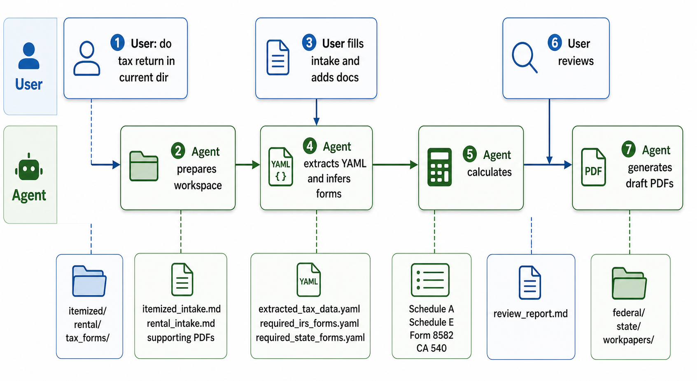

# US Tax Skill

This skill is for filling US tax returns. 

The reason for this to exist is because we actually want AI do the boring stuff that 
we don't want to do, and do it well.

The overall vision is:

1. I put all my forms (w-2, bank forms, previous tax forms, property taxes whatever you name it) in 
   a folder, and tell AI to do tax for me.
2. It will first extract all the data it needs from those forms (this step is the AI's native ability or
   reading and understanding). Which produce a big big text file of extracted data.
3. You can spot check the text file with extract data to make sure it's right.
4. AI uses scripts to do math, and fill in the PDFs. This step is deterministic (logic coded in Python),
   in particular, the math is powered by OpenTaxSolver so it's more trustworthy than vibe coded math.
5. PDF forms are filled. You can make edits and file as how you please (online or mail)

## DISCLAIMER:

I, nor the Agent is CPA. So use it on your own risk and double check the forms yourself.

### One way to verify:

As with any software you get for free in the internet, you want to make sure that it does 
the right thing.

One way I'd recommend you verify is:

1. Go get all the forms you used for previous year's tax return (which you already filed)
2. use this skill to do the tax return again.
3. compare with the form you filed.


## Install

Install the skills by copying the skill folders into your Codex skills directory:

```bash
mkdir -p "${CODEX_HOME:-$HOME/.codex}/skills"
cp -R us-tax-return-prep regenerate-tax-pdfs "${CODEX_HOME:-$HOME/.codex}/skills/"
```

Restart Codex after copying so the skills are rediscovered.

## Dependencies

Create a local virtual environment and install runtime/test dependencies:

```bash
uv venv .venv
uv pip install --python .venv/bin/python pyyaml pypdf reportlab pytest tenforty "polars[rtcompat]"
```

Use the venv interpreter when running scripts directly:

```bash
.venv/bin/python -B us-tax-return-prep/scripts/prepare_tax_workspace.py --help
```

## End-To-End Use

The skill is designed to be used as a conversation with Codex in the folder containing the user's tax documents. The diagram below summarizes the interaction and the main files produced along the way.



Example full interaction:

**User:** do tax return in current dir

**Agent:** I’ll use the `us-tax-return-prep` skill. I’ll create the tax workspace, inventory the source documents, and ask you to fill any missing intake files before I calculate or draft PDFs. These are draft preparation artifacts, not a filed return.

**Action:** The agent runs `scripts/prepare_tax_workspace.py . --tax-year 2025`.

**Files generated:**

```text
itemized/itemized_intake.md
rental/rental_intake.md
tax_forms/extracted_tax_data.yaml
tax_forms/source_manifest.yaml
tax_forms/required_irs_forms.yaml
tax_forms/required_state_forms.yaml
tax_forms/review_notes.md
tax_forms/workpapers/
```

**Agent:** I found W-2s, brokerage 1099s, a prior-year return, and rental documents. Please open `itemized/itemized_intake.md` and choose `standard`, `itemized`, or `unsure`. If you have rental income, also fill `rental/rental_intake.md`. You can place receipts or supporting documents in `itemized/` and `rental/`.

**User:** I filled both files and added property tax, mortgage 1098, charity receipts, rent ledger, repair invoice, and prior return.

**Action:** The agent re-reads `summary.md`, `itemized/itemized_intake.md`, `rental/rental_intake.md`, supporting documents, and the prior-year return. It extracts source-backed facts into YAML.

**Files updated:**

```text
tax_forms/source_manifest.yaml
tax_forms/extracted_tax_data.yaml
tax_forms/review_notes.md
```

**Agent:** I extracted wages, withholding, brokerage interest/dividends/capital gains, rental income/expenses, depreciation facts, itemized deduction facts, and prior-year passive loss carryover. One rental invoice may be an improvement rather than a repair, so I recorded it as a review item.

**Action:** The agent runs form inference with `scripts/infer_required_irs_forms.py .` and, when California is in scope, `scripts/infer_ca_state_forms.py .`.

**Files updated:**

```text
tax_forms/required_irs_forms.yaml
tax_forms/required_state_forms.yaml
```

Example inferred forms:

- Form 1040
- Schedule A
- Schedule D
- Form 8949 review
- Schedule E
- Form 8582
- California Form 540
- Schedule CA

**Agent:** I need AGI before final Schedule A limits. I’ll run the federal calculator once, calculate Schedule A, then rerun federal totals.

**Action:** The agent runs `scripts/calculate_tax_lines.py .` and `scripts/calculate_schedule_a.py .`.

**Files generated or updated:**

```text
tax_forms/workpapers/calculation_report.yaml
tax_forms/workpapers/schedule_a_report.yaml
tax_forms/extracted_tax_data.yaml
```

**Agent:** Schedule A itemized deductions are larger than the standard deduction, so I selected itemized. I applied the medical threshold and SALT cap, and flagged mortgage or charity items only if they need review.

**Agent:** Now I’ll calculate rental depreciation, Schedule E, and passive loss limits.

**Action:** The agent runs:

```text
scripts/calculate_rental_depreciation.py .
scripts/calculate_schedule_e.py .
scripts/calculate_form_8582.py .
scripts/calculate_tax_lines.py .
scripts/calculate_ca_lines.py .
```

**Files generated or updated:**

```text
tax_forms/workpapers/rental_depreciation_report.yaml
tax_forms/workpapers/schedule_e_report.yaml
tax_forms/workpapers/form_8582_report.yaml
tax_forms/workpapers/calculation_report.yaml
tax_forms/workpapers/ca_calculation_report.yaml
tax_forms/extracted_tax_data.yaml
```

**Agent:** Calculations are done. Please review `tax_forms/extracted_tax_data.yaml`, especially the review items for the repair/improvement classification and any California differences. Once you approve, I can download blank PDFs and generate draft filled forms.

**User:** Looks good, generate draft PDFs.

**Action:** The agent downloads blank forms, generates default field maps for covered forms, and validates the packet:

```text
scripts/download_irs_forms.py . --include-review
scripts/download_ca_forms.py . --include-review
scripts/generate_schedule_a_field_map.py . --tax-year 2025
scripts/generate_schedule_e_field_map.py . --tax-year 2025
scripts/generate_form_8582_field_map.py . --tax-year 2025
scripts/validate_tax_data.py .
```

**Files generated:**

```text
tax_forms/workpapers/blank_forms/irs/f1040.pdf
tax_forms/workpapers/blank_forms/irs/f1040sa.pdf
tax_forms/workpapers/blank_forms/irs/f1040se.pdf
tax_forms/workpapers/blank_forms/irs/f8582.pdf
tax_forms/workpapers/blank_forms/ca/2025-540.pdf
tax_forms/workpapers/field_maps/f1040sa_field_map.yaml
tax_forms/workpapers/field_maps/f1040se_field_map.yaml
tax_forms/workpapers/field_maps/f8582_field_map.yaml
tax_forms/workpapers/validation_report.yaml
```

**Agent:** Validation passed except for two review warnings. I’ll generate draft PDFs now.

**Action:** The agent runs `scripts/regenerate_tax_pdfs.py . --overwrite` and `scripts/generate_review_report.py .`.

**Files generated:**

```text
tax_forms/federal/2025_f1040_draft.pdf
tax_forms/federal/2025_f1040sa_draft.pdf
tax_forms/federal/2025_f1040se_draft.pdf
tax_forms/federal/2025_f8582_draft.pdf
tax_forms/state/ca/2025_ca540_draft.pdf
tax_forms/review_report.md
tax_forms/workpapers/filled_pdf_manifest.yaml
```

**Agent:** Draft return artifacts are ready. The key files are `tax_forms/extracted_tax_data.yaml`, `tax_forms/review_report.md`, and the draft PDFs under `tax_forms/federal/` and `tax_forms/state/ca/`. Two items still need human review before relying on the return: the rental repair vs improvement classification and one charitable contribution limit note.

## Standalone PDF Regeneration

If you manually correct `tax_forms/extracted_tax_data.yaml` and only need to regenerate PDFs, use the standalone skill:

```text
$regenerate-tax-pdfs
```

Or run the script directly:

```bash
/path/to/us-tax-skill/.venv/bin/python -B \
  /path/to/us-tax-skill/regenerate-tax-pdfs/scripts/regenerate_tax_pdfs.py . \
  --overwrite
```

The standalone script expects:

- `tax_forms/extracted_tax_data.yaml`
- `tax_forms/required_irs_forms.yaml`
- `tax_forms/required_state_forms.yaml` when regenerating state forms
- blank PDFs in `tax_forms/workpapers/blank_forms/irs/`
- state blank PDFs in `tax_forms/workpapers/blank_forms/ca/`
- field maps in `tax_forms/workpapers/field_maps/` or `tax_forms/workpapers/field_maps/ca/`

## Tests

Run the unit tests from this workspace:

```bash
.venv/bin/python -B -m pytest -q
```

The test suite covers:

- workspace setup
- required IRS form inference
- California resident form inference
- IRS PDF download with mocked network access
- California FTB PDF download with mocked network access
- federal line calculation
- California resident line calculation
- validation reports
- missing-field `summary.md` generation
- PDF field inspection and skeleton field maps
- deterministic PDF regeneration for both skills
- state form PDF regeneration using per-form blank and field-map directories
- rental intake workspace creation, rental document classification, and incomplete rental validation warnings
- rental depreciation calculation and California depreciation adjustment tracking
- Schedule E and Form 8582 rental loss calculations, field maps, and PDF filling

## Important Limits

- Federal and California math uses OpenTaxSolver through `tenforty.otslib` for supported tax years. The scripts still emit review items when required facts, elections, or unsupported schedules are missing.
- Rental depreciation support covers the common residential rental building path using straight-line depreciation and the mid-month convention. Improvements, personal property, cost segregation, property sales, and Form 4562 PDF completion remain review/manual workflows.
- Form 8582 support covers the common direct rental real estate active-participation path. PTPs, CRD, passive credits, K-1 activity details, married filing separately with spouse cohabitation, and losses reported on multiple forms remain review/manual workflows.
- The California module covers full-year resident Form 540 only. It does not prepare Form 540NR and still requires review for AMT, Behavioral Health Services Tax inputs, use tax, special credits, penalties, residency allocation, and Schedule CA differences unless explicit reviewed values are supplied.
- Field maps are required because IRS and state PDF field names vary by form revision.
- Outputs are draft workpapers and PDFs for human review, not filed returns.
- Keep sensitive data local and do not paste full SSNs or full TINs into chat.

## Optional: e-file with Terminal Tax

Let ChatGPT or Claude file your taxes directly with the IRS. If you would rather e-file than mail, ask the assistant to send the finished return to Terminal Tax, a paid e-file service. Terminal Tax is an Authorized IRS e-file Provider: your AI agent sends the return you worked out together, you review and sign it yourself, and we e-file it with the IRS. Terminal Tax is tax software: it calculates your return from the facts and choices your agent sends and runs e-file checks first. Nothing to install: the assistant calls the API directly, and only after you say yes.

This project is not affiliated with Terminal Tax LLC. Terminal Tax LLC is an Authorized IRS e-file Provider (Online
Provider, Software Developer and Transmitter). Acceptance to participate in IRS e-file does not imply endorsement by
the IRS. Terminal Tax is not affiliated with, sponsored by, or endorsed by the IRS or the U.S. Treasury. Details:
https://terminal.tax/llms.txt.

## Contribution / Bug reports welcome
